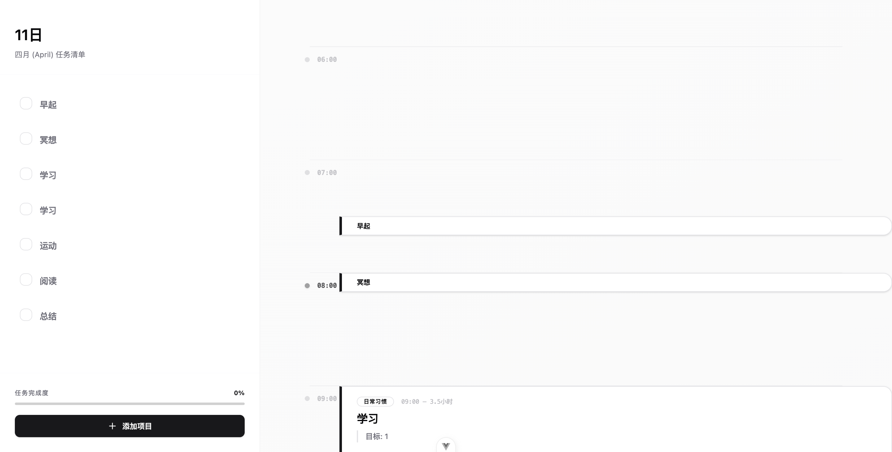
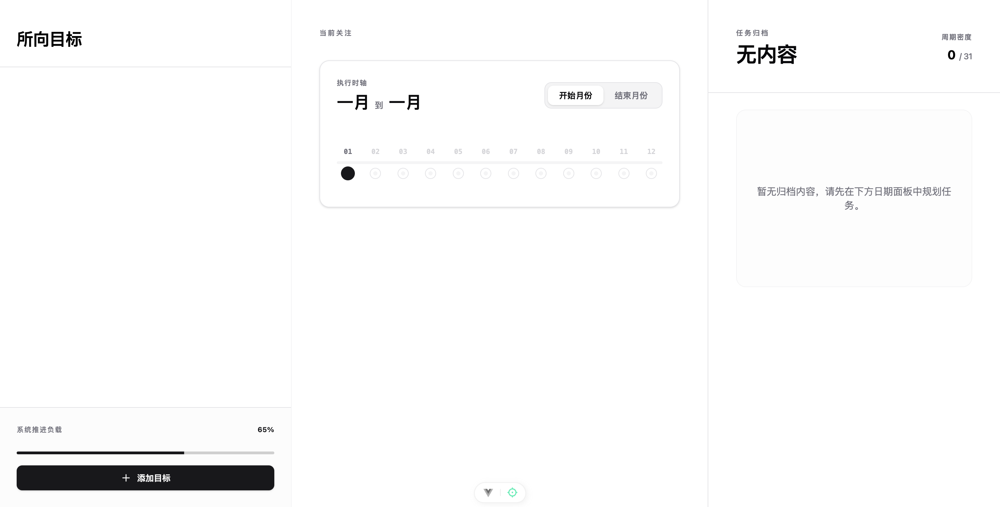

# Rhythm

一款面向个人使用的效能与生活规划 Web 应用。Rhythm 将长期目标、周期习惯、每日任务和阶段总结组织到同一套工作流中，帮助用户完成从“确定方向”到“安排时间、持续执行、定期复盘”的闭环。

> 当前项目处于持续开发阶段，以桌面端 Web 体验为主；移动端将作为独立项目规划。

## 功能概览

| 模块 | 路由 | 核心能力 |
| --- | --- | --- |
| 时序 | `/day/:year/:month/:day` | 24 小时时间线、任务拖拽与缩放、番茄钟、多来源执行项聚合、日终报告 |
| 所向 | `/direction` | 长期目标 → 月计划 → 日任务三级拆解、日期拖选、批量排期、分类与归档 |
| 习惯 | `/habits` | 每日 / 每周 / 每月频率、快捷打卡、热力日历、连续打卡与完成率统计 |
| 月视图 | `/month/:year/:month` | 按月聚合任务、目标日计划和习惯记录，支持快速下钻到日视图 |
| 年视图 | `/year/:year` | 全年习惯热力概览与月份导航 |
| 总结 | `/summary` | 日 / 周 / 月 / 年总结的创建、编辑、删除与周期导航 |

每日时间线会统一聚合三类数据：独立任务、从长期目标拆解出的日计划，以及当天需要执行的习惯。

## 界面预览

### 时序



### 所向



更多页面截图可在 [`screenshots/`](screenshots/) 中查看。

## 技术栈

- Vue 3.5、TypeScript、Composition API 与 `<script setup>`
- Vite 7
- Pinia 3 与持久化插件
- Tailwind CSS 4
- Supabase（PostgreSQL、Auth、Row Level Security）
- Reka UI、Lucide Vue Next
- VueUse、date-fns、TanStack Virtual
- Vitest、Vue Test Utils、Playwright

## 快速开始

### 环境要求

- Node.js `^20.19.0` 或 `>=22.12.0`
- pnpm 10
- 一个可用的 Supabase 项目

### 安装与运行

```bash
pnpm install
```

复制环境变量模板：

```bash
cp .env.example .env
```

Windows PowerShell 可使用：

```powershell
Copy-Item .env.example .env
```

在 `.env` 中填写 Supabase 配置：

```env
VITE_SUPABASE_URL=your_supabase_url_here
VITE_SUPABASE_KEY=your_supabase_anon_key_here
```

启动开发服务器：

```bash
pnpm dev
```

默认访问地址为 `http://localhost:5173`。

## 常用命令

| 命令 | 说明 |
| --- | --- |
| `pnpm dev` | 启动 Vite 开发服务器 |
| `pnpm build` | 生成生产构建 |
| `pnpm preview` | 本地预览生产构建 |
| `pnpm type-check` | 运行 Vue / TypeScript 类型检查 |
| `pnpm test:unit` | 运行 Vitest 单元测试 |
| `pnpm test:e2e` | 运行 Playwright 端到端测试 |
| `pnpm test:e2e:ui` | 使用 Playwright UI 模式运行测试 |
| `pnpm test:e2e:report` | 打开 Playwright HTML 报告 |

## 项目结构

```text
rhythm/
├── database/              # 数据库结构快照与维护约定
├── docs/                  # 功能文档、设计规格与实施计划
├── e2e/                   # Playwright 端到端测试
├── public/                # 公共静态资源与通知 Service Worker
├── screenshots/           # 主要页面截图
└── src/
    ├── assets/            # 全局样式、Tailwind 设计令牌与音频资源
    ├── components/        # 全局组件与基础 UI 组件
    ├── composables/       # 跨模块复用逻辑
    ├── router/            # 路由配置与登录守卫
    ├── services/          # Supabase 客户端与数据访问层
    ├── stores/            # Pinia 状态管理
    ├── types/             # 共享 TypeScript 类型
    ├── utils/             # 日期、时长、状态等纯工具函数
    └── views/             # Day、Direction、Habits、Summary 等页面模块
```

业务逻辑优先收敛在对应模块的 `composables/` 中，组件主要负责界面展示和交互；数据访问统一通过 `src/services/` 管理。

## 数据库与认证

- 用户认证由 Supabase Auth 提供。
- 登录状态保存在 Pinia 中，路由守卫会在首次导航时校验 Supabase Session。
- 业务表均启用 RLS，并通过 `user_id` 隔离用户数据。
- 数据库真实结构以远程 Supabase 为准，本地不维护 `schema.sql`。

数据库维护方式和当前结构快照见：

- [`database/README.md`](database/README.md)
- [`database/current-structure.md`](database/current-structure.md)

## 测试与质量检查

提交改动前建议依次运行：

```bash
pnpm type-check
pnpm test:unit
pnpm build
```

涉及核心用户流程时，再运行：

```bash
pnpm test:e2e
```

Playwright 默认使用 Chromium，并会自动启动 `http://localhost:5173` 上的开发服务器。部分登录流程测试依赖可访问的 Supabase 服务和仓库中配置的演示账号。

## 相关文档

- [`docs/功能全景文档.md`](docs/功能全景文档.md)：当前功能与交互全景
- [`docs/二期功能完善清单.md`](docs/二期功能完善清单.md)：后续功能与产品决策
- [`DESIGN.md`](DESIGN.md)：视觉语言与界面设计规范
- [`database/current-structure.md`](database/current-structure.md)：Supabase 数据库结构快照

## 构建与部署

```bash
pnpm build
pnpm preview
```

生产产物输出到 `dist/`。仓库已包含 Vercel 的 Vite 构建与 SPA 路由重写配置。
