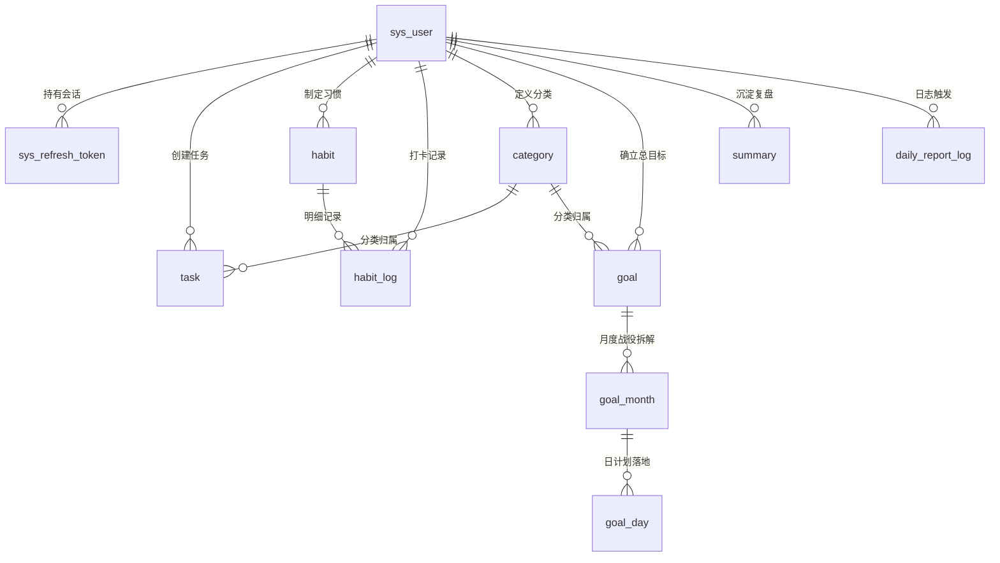

# 数据库架构设计

---

## 一、 实体关系图 (ER Diagram)

---

## 二、 原生枚举类型 (PostgreSQL Enums)

### 1. `habit_repeat_type` 习惯重复类型
| 枚举值 | 映射标签 | 说明 |
| :--- | :--- | :--- |
| `DAILY` | `'daily'` | 每日重复 |
| `WEEKLY` | `'weekly'` | 每周重复 (搭配 `repeat_days` 记录 1~7) |
| `MONTHLY` | `'monthly'` | 每月重复 (搭配 `repeat_days` 记录 1~31) |

### 2. `goal_status` 目标状态
| 枚举值 | 映射标签 | 说明 |
| :--- | :--- | :--- |
| `ACTIVE` | `'active'` | 进行中 / 激活 |
| `COMPLETED` | `'completed'` | 已达成 / 已完成 |
| `ARCHIVED` | `'archived'` | 已归档 / 已放弃 |

### 3. `summary_period_type` 复盘周期类型
| 枚举值 | 映射标签 | 说明 |
| :--- | :--- | :--- |
| `DAILY` | `'daily'` | 日度复盘 |
| `WEEKLY` | `'weekly'` | 周度复盘 |
| `MONTHLY` | `'monthly'` | 月度复盘 |
| `YEARLY` | `'yearly'` | 年度复盘 |

---

## 三、 数据字典

### 1. 认证与用户模块

#### 1.1 `sys_user` 用户表
| 列名 | 类型 | 可空 | 默认值 | 说明 |
| :--- | :--- | :---: | :--- | :--- |
| `id` | `uuid` | NO | `gen_random_uuid()` | 用户ID |
| `email` | `text` | NO | - | 用户邮箱 |
| `password_hash` | `text` | NO | - | 加密密码 |
| `name` | `text` | YES | - | 用户昵称 |
| `created_at` | `timestamptz` | NO | `now()` | 创建时间 |
| `updated_at` | `timestamptz` | NO | `now()` | 更新时间 |

- **约束**：`UNIQUE(email)`

#### 1.2 `sys_refresh_token` 刷新令牌表
| 列名 | 类型 | 可空 | 默认值 | 说明 |
| :--- | :--- | :---: | :--- | :--- |
| `id` | `uuid` | NO | `gen_random_uuid()` | 令牌ID |
| `user_id` | `uuid` | NO | - | 用户ID |
| `token_hash` | `text` | NO | - | 刷新令牌哈希 |
| `expires_at` | `timestamptz` | NO | - | 过期时间 |
| `revoked_at` | `timestamptz` | YES | - | 吊销时间 |
| `created_at` | `timestamptz` | NO | `now()` | 签发时间 |

- **约束**：`FOREIGN KEY (user_id) REFERENCES sys_user(id) ON DELETE CASCADE`, `UNIQUE(token_hash)`

---

### 2. 时序与待办模块

#### 2.1 `task` 任务表
| 列名 | 类型 | 可空 | 默认值 | 说明 |
| :--- | :--- | :---: | :--- | :--- |
| `id` | `uuid` | NO | `gen_random_uuid()` | 任务ID |
| `user_id` | `uuid` | NO | - | 用户ID |
| `category_id` | `uuid` | YES | - | 分类ID |
| `title` | `text` | NO | - | 任务名称 |
| `description` | `text` | YES | - | 任务描述 |
| `start_time` | `timestamptz` | YES | - | 计划开始时间 |
| `end_time` | `timestamptz` | YES | - | 计划结束时间 |
| `actual_start_time`| `timestamptz` | YES | - | 实际开始时间 |
| `actual_end_time` | `timestamptz` | YES | - | 实际结束时间 |
| `completed` | `boolean` | NO | `false` | 是否完成 |
| `created_at` | `timestamptz` | NO | `now()` | 创建时间 |
| `updated_at` | `timestamptz` | NO | `now()` | 更新时间 |

- **约束**：`FOREIGN KEY (user_id) REFERENCES sys_user(id) ON DELETE CASCADE`, `FOREIGN KEY (category_id) REFERENCES category(id) ON DELETE SET NULL`
- **索引**：`INDEX(user_id, start_time)`、`INDEX(user_id, completed)`、`INDEX(category_id)`

---

### 3. 习惯与打卡模块

#### 3.1 `habit` 习惯表
| 列名 | 类型 | 可空 | 默认值 | 说明 |
| :--- | :--- | :---: | :--- | :--- |
| `id` | `uuid` | NO | `gen_random_uuid()` | 习惯ID |
| `user_id` | `uuid` | NO | - | 用户ID |
| `title` | `text` | NO | - | 习惯名称 |
| `repeat_type` | `habit_repeat_type` | NO | - | 重复类型(daily/weekly/monthly) |
| `repeat_days` | `integer[]` | YES | `[]` | 频次生效天数集合 (周 1~7 或 月画刷 1~31) |
| `plan_time` | `time without time zone` | YES | - | 排期时间 |
| `duration` | `integer` | YES | - | 执行时长(分钟) |
| `archived` | `boolean` | NO | `false` | 是否归档 |
| `created_at` | `timestamptz` | NO | `now()` | 创建时间 |
| `updated_at` | `timestamptz` | NO | `now()` | 更新时间 |

- **约束**：`FOREIGN KEY (user_id) REFERENCES sys_user(id) ON DELETE CASCADE`
- **索引**：`INDEX(user_id, archived)`

#### 3.2 `habit_log` 习惯打卡日志表
| 列名 | 类型 | 可空 | 默认值 | 说明 |
| :--- | :--- | :---: | :--- | :--- |
| `id` | `uuid` | NO | `gen_random_uuid()` | 日志ID |
| `habit_id` | `uuid` | NO | - | 习惯ID |
| `user_id` | `uuid` | NO | - | 用户ID |
| `completed_at` | `timestamptz` | NO | `now()` | 打卡时间 |
| `value` | `integer` | YES | - | 完成数值 |
| `remark` | `text` | YES | - | 打卡心得备注 |

- **约束**：`FOREIGN KEY (habit_id) REFERENCES habit(id) ON DELETE CASCADE`, `FOREIGN KEY (user_id) REFERENCES sys_user(id) ON DELETE CASCADE`
- **索引**：`INDEX(habit_id, completed_at)`、`INDEX(user_id, completed_at)`

---

### 4. 分类与目标拆解模块

#### 4.1 `category` 分类表
| 列名 | 类型 | 可空 | 默认值 | 说明 |
| :--- | :--- | :---: | :--- | :--- |
| `id` | `uuid` | NO | `gen_random_uuid()` | 分类ID |
| `user_id` | `uuid` | NO | - | 用户ID |
| `name` | `text` | NO | - | 分类名称 |
| `sort_order` | `integer` | NO | `0` | 排序权重 |
| `created_at` | `timestamptz` | NO | `now()` | 创建时间 |
| `updated_at` | `timestamptz` | NO | `now()` | 更新时间 |

- **约束**：`FOREIGN KEY (user_id) REFERENCES sys_user(id) ON DELETE CASCADE`, `UNIQUE(user_id, name)`

#### 4.2 `goal` 目标表
| 列名 | 类型 | 可空 | 默认值 | 说明 |
| :--- | :--- | :---: | :--- | :--- |
| `id` | `uuid` | NO | `gen_random_uuid()` | 目标ID |
| `user_id` | `uuid` | NO | - | 用户ID |
| `category_id` | `uuid` | YES | - | 分类ID |
| `title` | `text` | NO | - | 目标名称 |
| `description` | `text` | YES | - | 目标描述 |
| `year` | `date` | YES | - | 所属年份 |
| `start_month` | `integer` | NO | - | 起始月份 |
| `end_month` | `integer` | NO | - | 结束月份 |
| `plan_time` | `time without time zone` | YES | - | 排期时间 |
| `duration` | `integer` | YES | - | 执行时长(分钟) |
| `carry_over_lookback_days` | `integer` | NO | - | 顺延回溯天数 |
| `priority` | `integer` | YES | `0` | 优先级 |
| `status` | `goal_status` | NO | `'active'` | 状态(active/completed/archived) |
| `created_at` | `timestamptz` | NO | `now()` | 创建时间 |
| `updated_at` | `timestamptz` | NO | `now()` | 更新时间 |

- **约束**：`FOREIGN KEY (user_id) REFERENCES sys_user(id) ON DELETE CASCADE`, `FOREIGN KEY (category_id) REFERENCES category(id) ON DELETE SET NULL`
- **索引**：`INDEX(user_id, status)`

#### 4.3 `goal_month` 月度目标表
| 列名 | 类型 | 可空 | 默认值 | 说明 |
| :--- | :--- | :---: | :--- | :--- |
| `id` | `uuid` | NO | `gen_random_uuid()` | 月度目标ID |
| `goal_id` | `uuid` | NO | - | 目标ID |
| `user_id` | `uuid` | NO | - | 用户ID |
| `title` | `text` | NO | - | 月度目标名称 |
| `description` | `text` | YES | - | 月度目标描述 |
| `month` | `date` | YES | - | 所属月份 |
| `plan_time` | `time without time zone` | YES | - | 排期时间 |
| `duration` | `integer` | YES | - | 执行时长(分钟) |
| `priority` | `integer` | YES | `0` | 优先级 |
| `status` | `goal_status` | NO | `'active'` | 状态(active/completed/archived) |
| `created_at` | `timestamptz` | NO | `now()` | 创建时间 |
| `updated_at` | `timestamptz` | NO | `now()` | 更新时间 |

- **约束**：`FOREIGN KEY (goal_id) REFERENCES goal(id) ON DELETE CASCADE`, `FOREIGN KEY (user_id) REFERENCES sys_user(id) ON DELETE CASCADE`
- **索引**：`INDEX(goal_id)`、`INDEX(user_id)`

#### 4.4 `goal_day` 日度目标表
| 列名 | 类型 | 可空 | 默认值 | 说明 |
| :--- | :--- | :---: | :--- | :--- |
| `id` | `uuid` | NO | `gen_random_uuid()` | 日度目标ID |
| `goal_month_id` | `uuid` | YES | - | 月度目标ID |
| `user_id` | `uuid` | NO | - | 用户ID |
| `title` | `text` | NO | - | 日度目标名称 |
| `description` | `text` | YES | - | 日度目标描述 |
| `date` | `date` | NO | - | 执行日期 |
| `plan_time` | `time without time zone` | YES | - | 排期时间 |
| `duration` | `integer` | YES | - | 执行时长(分钟) |
| `priority` | `integer` | YES | `0` | 优先级 |
| `status` | `goal_status` | NO | `'active'` | 状态(active/completed/archived) |
| `created_at` | `timestamptz` | NO | `now()` | 创建时间 |
| `updated_at` | `timestamptz` | NO | `now()` | 更新时间 |

- **约束**：`FOREIGN KEY (goal_month_id) REFERENCES goal_month(id) ON DELETE CASCADE`, `FOREIGN KEY (user_id) REFERENCES sys_user(id) ON DELETE CASCADE`
- **索引**：`INDEX(user_id, date)`、`INDEX(goal_month_id)`

---

### 5. 复盘总结模块

#### 5.1 `summary` 总结表
| 列名 | 类型 | 可空 | 默认值 | 说明 |
| :--- | :--- | :---: | :--- | :--- |
| `id` | `uuid` | NO | `gen_random_uuid()` | 总结ID |
| `user_id` | `uuid` | NO | - | 用户ID |
| `title` | `text` | YES | - | 总结标题 |
| `period_type` | `summary_period_type` | NO | - | 周期类型(daily/weekly/monthly/yearly) |
| `period_start` | `timestamptz` | NO | - | 周期开始时间 |
| `period_end` | `timestamptz` | NO | - | 周期结束时间 |
| `content` | `jsonb` | NO | `{}` | 结构化复盘内容(JSON) |
| `created_at` | `timestamptz` | NO | `now()` | 创建时间 |
| `updated_at` | `timestamptz` | NO | `now()` | 更新时间 |

- **约束**：`FOREIGN KEY (user_id) REFERENCES sys_user(id) ON DELETE CASCADE`
- **索引**：`INDEX(user_id, period_type, period_start)`

---

### 6. 系统报表模块

#### 6.1 `daily_report_log` 每日报告日志表
| 列名 | 类型 | 可空 | 默认值 | 说明 |
| :--- | :--- | :---: | :--- | :--- |
| `id` | `uuid` | NO | `gen_random_uuid()` | 日志ID |
| `user_id` | `uuid` | NO | - | 用户ID |
| `report_date` | `date` | NO | - | 报告日期 |
| `created_at` | `timestamptz` | NO | `now()` | 生成时间 |

- **约束**：`FOREIGN KEY (user_id) REFERENCES sys_user(id) ON DELETE CASCADE`, `UNIQUE(user_id, report_date)`
